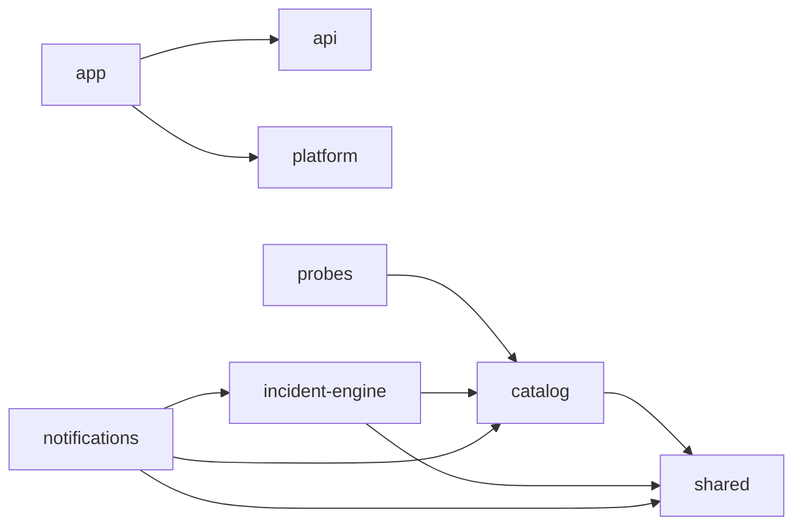

# Захист Лаб 1 — фундамент проєкту та стандарти

| Поле           | Значення                                                                                                                                                                                |
| -------------- | --------------------------------------------------------------------------------------------------------------------------------------------------------------------------------------- |
| Проєкт         | UW Dispatcher — Uptime & Webhook Dispatcher                                                                                                                                             |
| Гілка / PR     | `feature/lab1-foundation` → `main` (посилання на PR додається після відкриття)                                                                                                          |
| Перевірити все | `npm install && npm run verify`                                                                                                                                                         |
| Ключові файли  | [README](../../README.md) · [spec.md](../../spec.md) · [standards/](../../standards/README.md) · [adr/](../../adr/README.md) · [.dependency-cruiser.cjs](../../.dependency-cruiser.cjs) |

## 1. Що зроблено — відповідність завданню

| Вимога лабораторної                                    | Артефакт                                                                                                                                                                                                                                 | Як перевірити                                |
| ------------------------------------------------------ | ---------------------------------------------------------------------------------------------------------------------------------------------------------------------------------------------------------------------------------------- | -------------------------------------------- |
| Ідея, репозиторій, README                              | [README.md](../../README.md)                                                                                                                                                                                                             | —                                            |
| Пакети, стиль коду, форматтер, лінтер/статичний аналіз | `package.json`, `tsconfig.json`, `eslint.config.js`, `.prettierrc.json`, `.dependency-cruiser.cjs`, `knip.json`                                                                                                                          | `npm run verify:fast`                        |
| Git-hook: формат, лінтер, smoke-тест, збірка           | `.husky/pre-commit`, `.husky/commit-msg`, `.husky/pre-push`                                                                                                                                                                              | §3 нижче — реальні блокування                |
| Стандарти: формат spec                                 | [standards/spec-format.md](../../standards/spec-format.md)                                                                                                                                                                               | `npm run docs:check`                         |
| Стандарти: ADR (MADR)                                  | [standards/adr-format.md](../../standards/adr-format.md), [шаблон](../../standards/adr-template.md)                                                                                                                                      | `npm run docs:check`                         |
| Стандарти: Definition of Done                          | [standards/definition-of-done.md](../../standards/definition-of-done.md) + [PR-шаблон](../../.github/pull_request_template.md)                                                                                                           | чекліст у PR                                 |
| Стандарти: перелік перевірок                           | [standards/checks.md](../../standards/checks.md)                                                                                                                                                                                         | hooks + [CI](../../.github/workflows/ci.yml) |
| spec.md: компоненти та взаємодія                       | [spec.md §3](../../spec.md#3-компоненти-та-межі-модулів)                                                                                                                                                                                 | `npm run deps:check`                         |
| spec.md: дані та зв'язки (ER)                          | [spec.md §4](../../spec.md#4-модель-даних)                                                                                                                                                                                               | —                                            |
| spec.md: оновлення даних за сценаріями                 | [spec.md §5](../../spec.md#5-ключові-сценарії) (SC-01 – SC-09)                                                                                                                                                                           | —                                            |
| Аудит: структура vs spec, топ-3 залежності             | §6 нижче                                                                                                                                                                                                                                 | `npm run deps:graph`, `npm run unused:check` |
| ADR на теми проєкту                                    | [ADR-0002](../../adr/0002-job-scheduler-bullmq-redis.md) планувальник, [ADR-0003](../../adr/0003-at-least-once-delivery-with-idempotency-keys.md) доставка, [ADR-0004](../../adr/0004-time-series-in-postgres-partitions.md) часові ряди | `npm run docs:check`                         |

## 2. Інструменти та чому саме вони

| Інструмент                                                    | Роль                              | Чому                                                                                                    |
| ------------------------------------------------------------- | --------------------------------- | ------------------------------------------------------------------------------------------------------- |
| TypeScript 6 (`strict`, `noUncheckedIndexedAccess`, NodeNext) | статична типізація                | Ловить `undefined` і помилки контрактів між модулями. TS 7 несумісний з typescript-eslint (див. аудит). |
| ESLint 10 + typescript-eslint `strictTypeChecked`             | лінтер з інформацією про типи     | Floating promises, `any`, неповні `switch`, `console.*` — помилки, а не стиль.                          |
| Prettier                                                      | форматтер                         | Стиль не обговорюється; ESLint не дублює форматування (`eslint-config-prettier`).                       |
| dependency-cruiser                                            | межі модулів і шарів              | 21 правило архітектури з spec §3.4 ([ADR-0005](../../adr/0005-module-boundaries-as-code.md)).           |
| knip                                                          | зайві залежності, файли, експорти | Пряма відповідь на «зайві залежності» в аудиті.                                                         |
| `scripts/check-docs.ts`                                       | стандарти документації            | Формат ADR і spec, трасування FR/SC, синхронність spec ↔ правила меж.                                   |
| Vitest                                                        | unit + smoke                      | Нативний ESM/TS; той самий раннер для інтеграційних/E2E у Лаб 3; підтримується Stryker.                 |
| husky + lint-staged + commitlint                              | hooks                             | Перевірка лише staged-файлів у режимі `--check` (коміт блокується, а не тихо змінюється).               |
| GitHub Actions                                                | CI                                | Той самий `npm run verify` + `npm audit`; hook можна обійти, CI — ні.                                   |

## 3. Конвеєр реально працює: hook блокує брудний коміт

Hooks: **pre-commit** (~6 с) — `lint-staged` (Prettier `--check`, ESLint на staged-файлах) →
`typecheck` → `deps:check` → `docs:check`; **commit-msg** — commitlint; **pre-push** —
`npm run verify` (формат, лінтер, типи, межі, документація, knip, unit-тести, **збірка**,
**smoke-тест зібраного артефакту**). Нижче — фактичні виводи спроб закомітити порушення.

**A. Неформатований код** (`export const   x = 1` + `console.log`):

```text
✖ prettier --check
↓ eslint --max-warnings=0 --no-warn-ignored
✖ Failed to run tasks for staged files!
[warn] src/platform/dirty.ts
[warn] Code style issues found in the above file. Run Prettier with --write to fix.
husky - pre-commit script failed (code 1)
```

**B. Відформатований, але брудний код** (`console.log`, необроблений `fetch(...)`):

```text
✖ eslint --max-warnings=0 --no-warn-ignored:
src\platform\dirty.ts
  2:3  error  Unexpected console statement            no-console
  4:3  error  Promises must be awaited, ...            @typescript-eslint/no-floating-promises
✖ 2 problems (2 errors, 0 warnings)
husky - pre-commit script failed (code 1)
```

**C. Чистий за лінтером код, що порушує межу модулів** (`catalog` імпортує `probes`):

```text
> depcruise src --config .dependency-cruiser.cjs
  error catalog-is-upstream: src/modules/catalog/leak.ts → src/modules/probes/index.ts
x 1 dependency violations (1 errors, 0 warnings). 25 modules, 39 dependencies cruised.
husky - pre-commit script failed (code 1)
```

**D. Повідомлення коміту не за Conventional Commits** (`updated stuff`):

```text
✖   subject may not be empty [subject-empty]
✖   type may not be empty [type-empty]
husky - commit-msg script failed (code 1)
```

Усі коміти гілки пройшли через ці hooks (жодного `--no-verify`).

## 4. Стандарти: самостійні й захищені

Кожен стандарт має **правило → обґрунтування → механізм** ([standards/README.md](../../standards/README.md)).
Усе машинно-перевірюване перевіряє машина; решта — чекліст DoD у [PR-шаблоні](../../.github/pull_request_template.md).

Власні посилення відносно «звичайних» шаблонів:

- **MADR 4 посилено**: «Чинники рішення» і «Підтвердження» обов'язкові; кожен ADR мусить мати хоча б
  один «Погано, тому що» (у рішення завжди є ціна); рішення формулюється однією фразою «Обраний варіант: «…», тому що…».
- **Spec** має фіксовані 9 розділів, ID `FR/NFR/SC`, власний рядок трасування для кожного FR/SC і
  **синхронність з кодом**: кожне правило `.dependency-cruiser.cjs` має бути описане в spec §3.4.
- **DoD** розділяє 🤖-пункти (неможливо забути) і пункти для рев'ю; містить «Що не є Done».
- **Checks** — таблиця «перевірка → де запускається → від чого захищає»; вимкнення перевірки вимагає ADR.

**Перевірка самого чекера.** Навмисні порушення: в ADR-0002 невалідний статус і перейменований
розділ; новий ADR-0007 без розділів і поза індексом; зі spec прибрано опис правила `domain-is-pure`
і рядок трасування `FR-09`. Вивід (після виправлення вад, описаних нижче):

```text
docs:check found 14 problem(s):
  - adr/0002-job-scheduler-bullmq-redis.md: invalid status "done"
  - adr/0002-job-scheduler-bullmq-redis.md: missing or out-of-order section "### Підтвердження"
  - adr/0007-bad.md: missing or out-of-order section "## Контекст і постановка проблеми"
  - adr/0007-bad.md: missing or out-of-order section "## Чинники рішення"
  - adr/0007-bad.md: missing or out-of-order section "## Розглянуті варіанти"
  - adr/0007-bad.md: missing or out-of-order section "## Рішення"
  - adr/0007-bad.md: missing or out-of-order section "### Наслідки"
  - adr/0007-bad.md: missing or out-of-order section "### Підтвердження"
  - adr/0007-bad.md: missing or out-of-order section "## Переваги та недоліки варіантів"
  - adr/0007-bad.md: decision must start with «Обраний варіант: «...»»
  - adr/README.md: does not list 0007-bad.md
  - adr: ADR numbers must be sequential from 0001, gap at 7
  - spec.md: FR-09 has no row in §8
  - spec.md: dependency rule `domain-is-pure` is not documented in §3
```

Ця перевірка виявила **дві вади самого чекера**, обидві виправлено:

1. Назва варіанту, перенесена Prettier на новий рядок, давала хибне «decision must start with…» (`.+` не
   матчить `\n`) → регулярний вираз `«[^»]+»`.
2. Видалений рядок трасування `FR-09` **не** ловився, бо `FR-09` згадувався в рядку `SC-05` → тепер
   вимагається власний рядок `| FR-09 | … |` (у виводі вище — `FR-09 has no row in §8`).

## 5. Структура виведена зі spec

| Елемент spec                                                | Код                                                  | Захист межі                                                                                                          |
| ----------------------------------------------------------- | ---------------------------------------------------- | -------------------------------------------------------------------------------------------------------------------- |
| §3.1 процеси api / worker                                   | `src/app/api.main.ts` (worker — Лаб 2)               | `api-does-not-know-composition-root`                                                                                 |
| §3.1 модулі catalog, probes, incident-engine, notifications | `src/modules/<module>/index.ts` + `domain/`          | `module-public-api-only`, `outer-layers-use-public-api`                                                              |
| §3.2 напрям потоку даних                                    | `catalog ← probes ← incident-engine ← notifications` | `catalog-is-upstream`, `probes-do-not-know-consumers`, `incident-engine-does-not-send`, `notifications-do-not-probe` |
| §3.2 шари                                                   | `app → api → modules → platform → shared`            | `shared-is-pure`, `platform-knows-no-business`, `modules-know-no-transport`                                          |
| §3.5 порти `CheckResultHandler`, `MonitorChanged`           | `probes/ports.ts`, `catalog/ports.ts`                | `probes-do-not-know-consumers`, `catalog-is-upstream`                                                                |
| §4.2 власність таблиць                                      | (Лаб 2) `*.repository.ts` у модулі-власнику          | `sql-only-in-repositories`                                                                                           |
| NFR-05 логи з bpId                                          | `platform/logger.ts`                                 | `logger-impl-only-in-platform`, ESLint `no-console`                                                                  |

**Правила справді ловлять порушення.** Тимчасові файли з трьома порушеннями (доменний файл `catalog`
імпортує внутрішній файл `probes`, `platform/env` і Fastify; `incident-engine` імпортує `notifications`;
`platform` імпортує `catalog`) → 7 помилок від 6 різних правил:

```text
  error platform-knows-no-business: src/platform/__violation.ts → src/modules/catalog/index.ts
  error module-public-api-only: src/modules/catalog/domain/__violation.ts → src/modules/probes/domain/check-result.ts
  error incident-engine-does-not-send: src/modules/incident-engine/__violation.ts → src/modules/notifications/index.ts
  error http-framework-only-in-api: src/modules/catalog/domain/__violation.ts → node_modules/fastify/fastify.js
  error domain-is-pure: src/modules/catalog/domain/__violation.ts → src/platform/env.ts
  error domain-is-pure: src/modules/catalog/domain/__violation.ts → node_modules/fastify/fastify.js
  error catalog-is-upstream: src/modules/catalog/domain/__violation.ts → src/modules/probes/domain/check-result.ts
x 7 dependency violations (7 errors, 0 warnings). 26 modules, 41 dependencies cruised.
```

**Фактичний граф модулів** (`npm run deps:graph`, згенеровано з коду):



## 6. Аудит

### 6.1 Чи структура відповідає spec

| Що в spec                                                       | Стан у коді                                            | Висновок                                                                                |
| --------------------------------------------------------------- | ------------------------------------------------------ | --------------------------------------------------------------------------------------- |
| 4 модулі + api, platform, shared, app                           | Є, кожен з `index.ts`                                  | ✅ відповідає                                                                           |
| Напрям залежностей між модулями                                 | Граф вище збігається з §3.2; циклів немає              | ✅ відповідає                                                                           |
| Порт `MonitorChanged` у catalog (§3.5)                          | **Був відсутній** — знайдено під час аудиту            | 🔧 виправлено: `src/modules/catalog/ports.ts`                                           |
| `incident-engine → probes` (споживає `CheckResult`)             | Ребра ще немає — сервіс оцінки стану з'явиться в Лаб 2 | ⏳ очікувано; правило `probes-do-not-know-consumers` уже гарантує правильний напрям     |
| `api` не залежить від модулів                                   | Так — бо сервісів ще немає (лише `/health`)            | ⏳ Лаб 2; `outer-layers-use-public-api` уже діє                                         |
| worker-процес, `platform/db`, `platform/queue`, контекст `bpId` | Ще немає                                               | ⏳ Лаб 2; правила `sql-only-in-repositories`, `queue-only-in-platform` написані наперед |

### 6.2 Топ-3 зайві / неправильні залежності

1. **Неправильна залежність модулів: конфігурація всередині `api`.** Ідея проєкту описує `api` як
   «управління конфігурацією». Тоді `probes` (читає монітори) і `notifications` (читає канали)
   залежали б від HTTP-шару, а worker-процес тягнув би Fastify. **Виправлено:** конфігурацію винесено
   в модуль `catalog`, `api` — лише транспорт. **Захист:** `modules-know-no-transport`,
   `http-framework-only-in-api`, `catalog-is-upstream`.
2. **Неправильна залежність модулів: `incident-engine → notifications` (прямий виклик відправки).**
   Найпростіша реалізація «при переході стану надіслати сповіщення» створює залежність проти потоку
   даних (а `notifications` уже читає інциденти → цикл) і губить сповіщення, якщо процес упаде між
   комітом і відправкою. **Виправлено в дизайні:** transactional outbox (`incident_events`),
   `notifications` залежить лише від контракту `IncidentEvent` ([ADR-0003](../../adr/0003-at-least-once-delivery-with-idempotency-keys.md)).
   **Захист:** `incident-engine-does-not-send`.
3. **Неправильна / зайва npm-залежність.**
   - `typescript@latest` = 7.0.2 несумісний з `typescript-eslint@8.74` (`peerDependencies: typescript <6.1.0`) →
     закріплено `typescript ~6.0.3`, причина записана в ADR-0001 і в повідомленні коміту.
   - knip знайшов: `pino-pretty` — невикористана devDependency (підключено в `dev:api`, лишається
     лише dev: у production логи JSON); `@commitlint/cli`, `lint-staged` — невикористані, поки не було
     hooks; експортовані, але ніде не використані `ApiDependencies`, `HealthResponse` — прибрано з експорту.

Перевірено й залишено свідомо:

- `pino` оголошено явно, хоча його приносить `fastify`: код імпортує його напряму, тож без оголошення
  спрацювало б `no-undeclared-packages`. Дублювання версій немає: `npm ls pino` → `pino@10.4.0 deduped`.
- `api` залежав від типу `Logger` з pino, що конфліктувало з generic-ами Fastify (потрібен був
  type cast) → `api` тепер приймає `FastifyBaseLogger`, cast прибрано.
- Свідомо **не** додано: `dotenv` (є `node --env-file`), `axios` (вбудований `fetch`), `node-cron`
  (відкинуто в ADR-0002), `ts-node` (є `tsx`).

### 6.3 Обмеження й ризики

- Hook можна обійти `--no-verify` → гарантією є CI; для `main` слід увімкнути branch protection з
  обов'язковим статусом `ci / verify` (налаштування GitHub, поза репозиторієм).
- Правила меж — регулярні вирази шляхів: перейменування теки може тихо вимкнути правило.
  Пом'якшення — процедура з навмисними порушеннями (§5) при зміні конфігурації.
- `docs:check` перевіряє структуру, а не якість аргументації — це пункт DoD для рев'ю.

## 7. Як відтворити

```bash
npm install                  # залежності + встановлення hooks
npm run verify               # увесь конвеєр (= pre-push = CI)
npm run deps:graph           # граф модулів
npm run unused:check         # зайві залежності/файли/експорти
npm run docs:check           # стандарти spec/ADR
```

## 8. Очікувані питання

- **Чому BullMQ, а не cron?** Кілька воркерів без дублікатів тіку і розклад, що переживає рестарт
  (NFR-06, NFR-03). Ціна — Redis і dual-write, компенсована звіркою розкладу ([ADR-0002](../../adr/0002-job-scheduler-bullmq-redis.md)).
- **Чому доставки не в BullMQ?** Стан доставки і журнал спроб мають одне джерело істини, транзакційне з
  подіями інцидентів; навантаження мале ([ADR-0003](../../adr/0003-at-least-once-delivery-with-idempotency-keys.md)).
- **Чому не exactly-once?** Telegram і SMTP не мають двофазного протоколу; втрачена відповідь після
  успішної обробки нерозрізнима з неуспіхом. Тому at-least-once + стабільний `Idempotency-Key`.
- **Чому партиції за днями, а не TimescaleDB?** Retention за O(1) і pruning без розширень і нового
  образу БД; ціна — власний код обслуговування партицій ([ADR-0004](../../adr/0004-time-series-in-postgres-partitions.md)).
- **Як гарантується «один відкритий інцидент»?** Частковий унікальний індекс
  `UNIQUE(monitor_id) WHERE status = 'open'` — на рівні БД, а не лише в коді.
- **Як захищено підписку на чужий канал?** Складені FK `(monitor_id, owner_id)` і `(channel_id, owner_id)` у `monitor_channels`.
