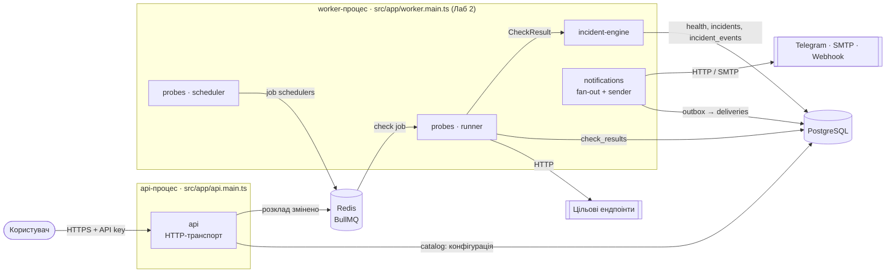
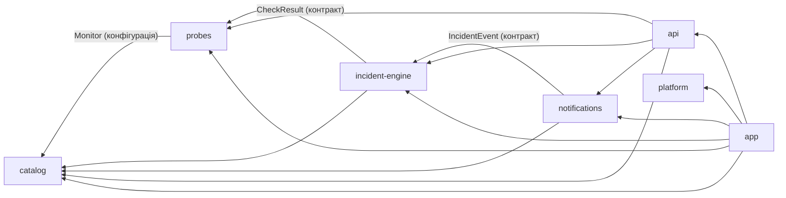
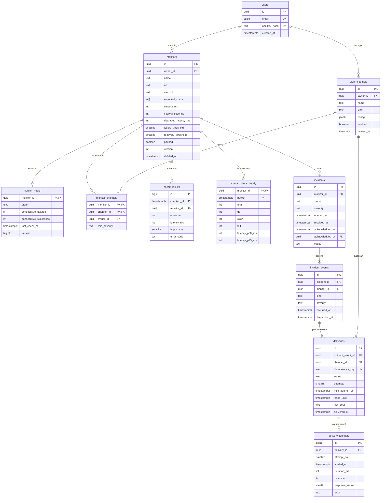
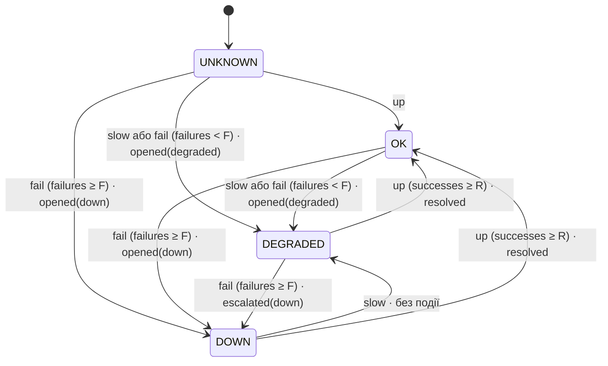

# Специфікація: UW Dispatcher

| Поле          | Значення                                                                       |
| ------------- | ------------------------------------------------------------------------------ |
| Статус        | Чернетка v0.1 — Лаб 1: компоненти, межі модулів, модель даних, оновлення даних |
| Оновлено      | 2026-11-24                                                                     |
| Формат        | [standards/spec-format.md](standards/spec-format.md)                           |
| Рішення       | [adr/](adr/README.md)                                                          |
| Перевіряється | `npm run docs:check` (структура, ID, трасування), `npm run deps:check` (межі)  |

## 1. Контекст і цілі

**Проблема.** Команди дізнаються про падіння сервісів від користувачів. Потрібна система, яка
сама періодично опитує HTTP-ендпоінти, відрізняє короткий збій від реального падіння і надійно
доставляє сповіщення в потрібні канали: не губить їх і не спамить дублікатами.

**Користувач.** Розробник / on-call інженер, який реєструє ендпоінти, налаштовує канали
(Telegram, Email, Webhook) і переглядає інциденти, історію перевірок і журнал доставок.

**Цілі.**

- G1. Виявити падіння не пізніше ніж за `interval × failureThreshold` (типово 60 с × 3 = 3 хв).
- G2. Жодне сповіщення про відкриття/закриття інциденту не губиться (at-least-once).
- G3. Не надсилати дублікати й «флапаючі» сповіщення (гістерезис + ключі ідемпотентності).
- G4. Зберігати історію перевірок для метрик uptime/латентності з контрольованим ростом обсягу.

**Поза межами.** Мультирегіональні проби, браузерні сценарії, ротації чергувань, білінг, UI
(інтерфейс системи — HTTP API).

**Глосарій.**

| Термін                | Значення                                                                                     |
| --------------------- | -------------------------------------------------------------------------------------------- |
| Монітор               | Зареєстрований ендпоінт + політика перевірок (інтервал, таймаут, пороги).                    |
| Перевірка (check)     | Одна спроба HTTP-запиту. Результат (outcome): `up`, `slow` або `fail`.                       |
| Стан здоров'я         | `UNKNOWN`, `OK`, `DEGRADED`, `DOWN` — стан машини станів монітора.                           |
| Інцидент              | Проміжок часу, коли монітор не в `OK`. Має події `opened`, `escalated`, `resolved`.          |
| Важливість (severity) | `degraded` або `down`; у інциденту — пікова важливість за весь час.                          |
| Канал                 | Адреса доставки: Telegram-чат, email або webhook URL.                                        |
| Підписка              | Зв'язок монітор ↔ канал з мінімальною важливістю, з якої канал отримує сповіщення.           |
| Доставка (delivery)   | Відправка однієї події інциденту в один канал; має спроби (attempts) і ключ ідемпотентності. |
| bpId                  | Business-process ID: кореляційний ідентифікатор HTTP-запиту або фонової задачі.              |

## 2. Вимоги

### Функціональні

| ID    | Вимога                                                                                                                                       |
| ----- | -------------------------------------------------------------------------------------------------------------------------------------------- |
| FR-01 | Користувач реєструється й отримує API-ключ (показується один раз); усі інші запити автентифікуються цим ключем.                              |
| FR-02 | Користувач створює, змінює, ставить на паузу, відновлює й видаляє монітор (URL, метод, очікувані статуси, таймаут, інтервал, пороги).        |
| FR-03 | Система перевіряє кожен активний монітор зі своїм інтервалом, а також на вимогу («перевірити зараз»), і зберігає результат.                  |
| FR-04 | Результат перевірки класифікується як `up` / `slow` / `fail` за HTTP-статусом, латентністю й типом помилки.                                  |
| FR-05 | Стан монітора змінюється за машиною станів OK → DEGRADED → DOWN з порогами послідовних результатів (SC-03).                                  |
| FR-06 | Вихід зі стану OK відкриває інцидент, DEGRADED → DOWN ескалює, повернення в OK закриває. На монітор — не більше одного відкритого інциденту. |
| FR-07 | Користувач створює канали (Telegram / Email / Webhook) і підписує на них монітори з мінімальною важливістю.                                  |
| FR-08 | Кожна подія інциденту доставляється в кожен відповідний канал з ретраями (експоненційний backoff + jitter) і ключем ідемпотентності.         |
| FR-09 | Webhook-запит підписується HMAC-SHA256 (`X-UW-Signature`) і містить заголовок `Idempotency-Key`.                                             |
| FR-10 | Користувач переглядає інциденти з подіями й доставками, підтверджує (acknowledge) інцидент, повторно запускає «мертву» доставку.             |
| FR-11 | Користувач отримує метрики монітора за період: uptime %, p50/p95 латентності, кількість інцидентів.                                          |

### Нефункціональні

| ID     | Вимога                                                                                                                                |
| ------ | ------------------------------------------------------------------------------------------------------------------------------------- |
| NFR-01 | Цільовий масштаб: 10 000 моніторів × інтервал 60 с ⇒ ~167 перевірок/с, ~14,4 млн рядків `check_results` на добу.                      |
| NFR-02 | Сповіщення `opened` доставляється в доступний канал ≤ 60 с після переходу стану (p95).                                                |
| NFR-03 | Падіння чи перезапуск будь-якого процесу не губить подій інцидентів і доставок (at-least-once).                                       |
| NFR-04 | Сирі результати перевірок зберігаються 30 днів, погодинні агрегати — 1 рік; видалення старих даних — O(1) (`DROP` партиції).          |
| NFR-05 | Кожен рядок логу (HTTP, сервіси, БД, воркери) містить `bpId`; за ним знаходяться всі операції одного запиту чи задачі.                |
| NFR-06 | Воркери масштабуються горизонтально без дублювання перевірки одного монітора в одному тіку.                                           |
| NFR-07 | Секрети (API-ключі, токени ботів, signing secrets) не потрапляють у логи й відповіді API; API-ключі зберігаються лише як SHA-256 хеш. |
| NFR-08 | Чужі ресурси недоступні: запит до монітора/каналу/інциденту іншого користувача повертає 404 (не розкриває існування).                 |

## 3. Компоненти та межі модулів

### 3.1 Процеси та компоненти

Одна кодова база — модульний моноліт ([ADR-0001](adr/0001-modular-monolith-on-typescript.md)) —
запускається як два типи процесів з різними composition roots. Масштабуються незалежно: навантаження
проб не впливає на латентність API.



| Модуль            | Відповідальність                                                                                   | Власні таблиці                                            | Публічний API (`index.ts`)                                      |
| ----------------- | -------------------------------------------------------------------------------------------------- | --------------------------------------------------------- | --------------------------------------------------------------- |
| `catalog`         | Конфігурація користувача: користувачі, монітори, канали, підписки; інваріанти конфігурації.        | `users`, `monitors`, `alert_channels`, `monitor_channels` | Типи `Monitor`, `AlertChannel`, `Subscription`; сервіси (Лаб 2) |
| `probes`          | Розклад перевірок, виконання HTTP-запиту, класифікація `up/slow/fail`, запис результату, агрегати. | `check_results`, `check_rollups_hourly`                   | `CheckResult`, порт `CheckResultHandler`                        |
| `incident-engine` | Машина станів OK → DEGRADED → DOWN, інциденти, події переходів (transactional outbox).             | `monitor_health`, `incidents`, `incident_events`          | `IncidentEvent`, `MonitorHealth`                                |
| `notifications`   | Fan-out подій у доставки за підписками, відправка в канали, ретраї з backoff, «мертві» доставки.   | `deliveries`, `delivery_attempts`                         | `Delivery`, `RetryPolicy`                                       |
| `api`             | HTTP: маршрути, схеми запитів/відповідей, автентифікація, глобальний обробник помилок.             | —                                                         | `buildServer`                                                   |
| `platform`        | Технічна інфраструктура без бізнес-логіки: env, логер з `bpId`, пул БД, черга, годинник.           | —                                                         | `loadEnv`, `createLogger`, …                                    |
| `shared`          | Чисте ядро без залежностей: `Brand`, утиліти.                                                      | —                                                         | `Brand`                                                         |
| `app`             | Composition roots: створюють ресурси й зв'язують модулі (єдине місце, що знає всі реалізації).     | —                                                         | —                                                               |

> **Відхилення від початкової ідеї.** В ідеї проєкту `api` — це «управління конфігурацією». Якщо
> залишити конфігурацію всередині `api`, то `probes` і `notifications` мусили б імпортувати HTTP-шар,
> щоб прочитати монітори й канали, а worker-процес тягнув би Fastify. Тому конфігурацію винесено в
> окремий модуль `catalog`, а `api` — лише транспорт (див. аудит у [defense/lab1](defense/lab1/DEFENSE.md)).

### 3.2 Потік даних і напрям залежностей

Модулі утворюють конвеєр. Залежність завжди спрямована **проти потоку даних**: споживач залежить
від опублікованого контракту постачальника, постачальник не знає споживачів. Споживачів
підключає composition root через порти (`CheckResultHandler`, `MonitorChanged`).



Шари (дозволений напрям — лише вниз): `app` → `api` → `modules/*` → `platform` → `shared`.

### 3.3 Структура репозиторію (виведена з компонентів)

```text
src/
├── app/                 # composition roots: api.main.ts (+ worker.main.ts у Лаб 2)
├── api/                 # HTTP-транспорт: server.ts, routes/*.routes.ts, (error-handler.ts)
├── modules/
│   ├── catalog/         # index.ts · domain/ · *.service.ts · *.repository.ts
│   ├── probes/          # index.ts · domain/ · ports.ts · (scheduler, runner)
│   ├── incident-engine/ # index.ts · domain/ (машина станів — чиста функція)
│   └── notifications/   # index.ts · domain/ · channels/ (telegram, email, webhook)
├── platform/            # env.ts · logger.ts · (db/, queue/, context.ts)
└── shared/              # brand.ts
test/smoke/              # smoke-тест зібраного артефакту
scripts/check-docs.ts    # перевірка стандартів документації
```

Усередині модуля: `index.ts` — єдина точка входу для інших модулів; `domain/` — типи й чисті
правила (без IO); `*.service.ts` — бізнес-операції й перевірка доступу; `*.repository.ts` —
єдине місце SQL і транзакцій (Лаб 2).

### 3.4 Межі модулів як код

Кожне правило нижче реалізоване в [`.dependency-cruiser.cjs`](.dependency-cruiser.cjs) і блокує
коміт (pre-commit) та CI. `npm run docs:check` перевіряє, що кожне правило конфігурації описане
тут ([ADR-0005](adr/0005-module-boundaries-as-code.md)).

| Правило                              | Що забороняє                                                       | Навіщо                                                                     |
| ------------------------------------ | ------------------------------------------------------------------ | -------------------------------------------------------------------------- |
| `no-circular`                        | Цикли імпортів.                                                    | Порядок ініціалізації визначений; модуль можна винести в сервіс.           |
| `no-orphans`                         | Файли, які ніхто не імпортує й які нічого не імпортують.           | Мертвий код.                                                               |
| `not-to-unresolvable`                | Імпорти, що не резолвляться.                                       | Зламані шляхи ловляться до збірки.                                         |
| `no-undeclared-packages`             | npm-імпорти, не оголошені в `package.json`.                        | Транзитивні залежності не «протікають» у код.                              |
| `no-dev-deps-in-runtime`             | Runtime-код, що імпортує devDependencies.                          | У production-образі devDependencies немає.                                 |
| `no-tests-from-runtime`              | Runtime-код, що імпортує тести.                                    | Тестовий код не потрапляє в збірку.                                        |
| `shared-is-pure`                     | `shared/` імпортує будь-що поза `shared/`.                         | Ядро без залежностей, доступне всім шарам.                                 |
| `platform-knows-no-business`         | `platform/` імпортує модулі, `api` чи `app`.                       | Інфраструктура перевикористовується без бізнес-контексту.                  |
| `modules-know-no-transport`          | Модулі імпортують `api` чи `app`.                                  | Ті самі сервіси працюють у api- і worker-процесі.                          |
| `api-does-not-know-composition-root` | `api` імпортує `app`.                                              | Транспорт не знає, як збираються залежності.                               |
| `module-public-api-only`             | Імпорт внутрішніх файлів іншого модуля (оминаючи `index.ts`).      | Модуль можна рефакторити всередині, не ламаючи інших.                      |
| `outer-layers-use-public-api`        | `api`/`app` імпортують внутрішні файли модулів.                    | Те саме для зовнішніх шарів.                                               |
| `catalog-is-upstream`                | `catalog` імпортує `probes`, `incident-engine`, `notifications`.   | Конфігурація не залежить від конвеєра.                                     |
| `probes-do-not-know-consumers`       | `probes` імпортує `incident-engine` чи `notifications`.            | Результат публікується через порт `CheckResultHandler`.                    |
| `incident-engine-does-not-send`      | `incident-engine` імпортує `notifications`.                        | Події пишуться в outbox; доставка — відповідальність споживача (ADR-0003). |
| `notifications-do-not-probe`         | `notifications` імпортує `probes`.                                 | Сповіщення залежать лише від контракту подій.                              |
| `domain-is-pure`                     | `domain/` імпортує платформу, npm-пакети, IO або не-доменні файли. | Доменні правила тестуються без моків і детерміновано.                      |
| `http-framework-only-in-api`         | Fastify поза `api`/`app`.                                          | Worker не тягне HTTP-фреймворк; бізнес-код не знає HTTP.                   |
| `sql-only-in-repositories`           | Драйвер БД поза `*.repository.ts` і `platform/db`.                 | SQL і транзакції лише в репозиторіях (вимога Лаб 2).                       |
| `queue-only-in-platform`             | BullMQ/ioredis поза `platform/queue`.                              | Планувальник замінюваний (in-memory для тестів, ADR-0002).                 |
| `logger-impl-only-in-platform`       | Прямий імпорт `pino` поза `platform/`.                             | Кожен рядок логу проходить через логер з `bpId` (NFR-05).                  |

### 3.5 Взаємодія модулів

| Взаємодія                       | Механізм                                                                                | Чому так                                                                   |
| ------------------------------- | --------------------------------------------------------------------------------------- | -------------------------------------------------------------------------- |
| api → catalog / інші модулі     | Синхронний виклик сервісу через `index.ts`.                                             | Запит користувача потребує відповіді одразу.                               |
| catalog → probes (розклад)      | Порт `MonitorChanged` (підключається в `app`) + періодична звірка розкладу з БД.        | Dual-write PostgreSQL ↔ Redis: подія для швидкості, звірка для надійності. |
| probes → incident-engine        | Порт `CheckResultHandler`, синхронно в тій самій задачі перевірки.                      | Оцінка стану одразу після перевірки, без проміжної черги.                  |
| incident-engine → notifications | Transactional outbox: `incident_events.dispatched_at IS NULL`.                          | Подія фіксується в тій самій транзакції, що й перехід стану (ADR-0003).    |
| notifications → канали          | Черга в таблиці `deliveries` (lease через `FOR UPDATE SKIP LOCKED`) + ретраї з backoff. | Одне джерело істини про стан доставки й журнал спроб.                      |

## 4. Модель даних

### 4.1 ER-діаграма



### 4.2 Власники таблиць та інваріанти

Кожна таблиця має **одного модуля-власника**: лише його репозиторії пишуть у неї. Інші модулі
читають через публічний API власника.

| Таблиця                | Власник         | Ключові обмеження та індекси                                                                                                                                                                                            |
| ---------------------- | --------------- | ----------------------------------------------------------------------------------------------------------------------------------------------------------------------------------------------------------------------- |
| `users`                | catalog         | `UNIQUE(email)`, `UNIQUE(api_key_hash)`.                                                                                                                                                                                |
| `monitors`             | catalog         | `CHECK(degraded_latency_ms < timeout_ms)`, `CHECK(interval_seconds BETWEEN 30 AND 3600)`, `CHECK(failure_threshold >= 1)`; `UNIQUE(owner_id, name) WHERE deleted_at IS NULL`; `UNIQUE(id, owner_id)` для складеного FK. |
| `alert_channels`       | catalog         | `CHECK(kind IN ('telegram','email','webhook'))`; `config` валідовано схемою за `kind`; `UNIQUE(id, owner_id)`.                                                                                                          |
| `monitor_channels`     | catalog         | Складені FK `(monitor_id, owner_id) → monitors(id, owner_id)` і `(channel_id, owner_id) → alert_channels(id, owner_id)`: **БД не дозволяє підписати чужий канал**.                                                      |
| `monitor_health`       | incident-engine | Створюється ліниво при першій перевірці (`INSERT … ON CONFLICT DO NOTHING`); `version` — оптимістичне блокування.                                                                                                       |
| `check_results`        | probes          | `PARTITION BY RANGE (checked_at)`, щоденні партиції ([ADR-0004](adr/0004-time-series-in-postgres-partitions.md)); PK `(id, checked_at)`; локальний індекс `(monitor_id, checked_at DESC)`.                              |
| `check_rollups_hourly` | probes          | PK `(monitor_id, bucket)`; `PARTITION BY RANGE (bucket)`, місячні партиції; рахується до видалення сирої партиції.                                                                                                      |
| `incidents`            | incident-engine | `UNIQUE(monitor_id) WHERE status = 'open'` — **не більше одного відкритого інциденту (FR-06) на рівні БД**; `CHECK((status = 'resolved') = (resolved_at IS NOT NULL))`.                                                 |
| `incident_events`      | incident-engine | `UNIQUE(incident_id, kind)` — повторна обробка тієї ж перевірки не створить другу подію; частковий індекс `(occurred_at) WHERE dispatched_at IS NULL` для outbox.                                                       |
| `deliveries`           | notifications   | `UNIQUE(idempotency_key)`, де ключ = `{incident_event_id}:{channel_id}`; індекс `(next_attempt_at) WHERE status IN ('pending','retry_scheduled')`.                                                                      |
| `delivery_attempts`    | notifications   | `UNIQUE(delivery_id, attempt_no)`; лише вставка (append-only журнал).                                                                                                                                                   |

Зауваження щодо `check_results`: інциденти **не** мають FK на конкретну перевірку — PK
партиціонованої таблиці містить `checked_at`, а сирі дані видаляються через 30 днів, тоді як
інциденти живуть довше. Інцидент зберігає `cause` (код помилки) і `opened_at`.

## 5. Ключові сценарії

Формат кожного сценарію — [standards/spec-format.md](standards/spec-format.md#шаблон-сценарію).
Тут зафіксовано, **які дані змінюються** і в якій транзакції; деталі API й помилок — у §6–§7.

### SC-01 Реєстрація користувача

- **Тригер:** `POST /v1/users {email}`.
- **Зміни даних:** `INSERT users(email, api_key_hash = sha256(key))` — одна транзакція (catalog).
- **Інваріанти:** email унікальний (`409` при дублікаті); сирий ключ не зберігається й не логується.
- **Результат:** `201` + API-ключ (показується один раз).

### SC-02 Створення монітора з підписками

- **Тригер:** `POST /v1/monitors {name, url, …, channels: [{channelId, minSeverity}]}`.
- **Кроки та зміни даних:**
  1. catalog (одна транзакція): `INSERT monitors`; `INSERT monitor_channels` для кожної підписки
     (складений FK гарантує, що канали належать тому самому користувачу).
  2. Після коміту catalog публікує `MonitorChanged{id, intervalSeconds, paused}` → probes
     створює/оновлює job scheduler `monitor:{id}` у Redis.
- **Інваріанти:** якщо крок 2 не вдався (Redis недоступний), монітор існує без розкладу → його
  підхопить періодична звірка розкладу (≤ 60 с). Відповідь клієнту не залежить від Redis.
- **Результат:** `201` + монітор; `monitor_health` ще не існує (стан `UNKNOWN`).

### SC-03 Перевірка й оцінка стану

```mermaid
sequenceDiagram
  autonumber
  participant R as Redis (BullMQ)
  participant P as probes.runner
  participant T as Цільовий ендпоінт
  participant E as incident-engine
  participant DB as PostgreSQL

  R->>P: job check(monitorId) за розкладом
  P->>DB: SELECT monitor (catalog API)
  P->>T: HTTP-запит з таймаутом
  T-->>P: статус / помилка / таймаут
  P->>P: classify → up | slow | fail
  P->>DB: INSERT check_results (партиція дня)
  P->>E: CheckResultHandler(result)
  E->>DB: BEGIN; SELECT monitor_health … FOR UPDATE; SELECT incident WHERE open
  E->>E: transition(health, incident, outcome, policy) — чиста функція
  E->>DB: UPDATE monitor_health; INSERT/UPDATE incidents; INSERT incident_events; COMMIT
```

**Класифікація (FR-04):** статус ∈ `expectedStatus` і латентність ≤ `degradedLatencyMs` → `up`;
статус ∈ `expectedStatus`, але повільніше → `slow`; таймаут, DNS/TCP/TLS-помилка або статус поза
`expectedStatus` → `fail`.

**Лічильники:** `up` → `successes+1, failures=0`; `slow` → обидва `=0`; `fail` → `failures+1, successes=0`.

**Машина станів (FR-05, FR-06)** — F = `failureThreshold`, R = `recoveryThreshold`:



| Поточний стан | `up`                          | `slow`   | `fail`                         |
| ------------- | ----------------------------- | -------- | ------------------------------ |
| UNKNOWN, OK   | OK                            | DEGRADED | failures ≥ F ? DOWN : DEGRADED |
| DEGRADED      | successes ≥ R ? OK : DEGRADED | DEGRADED | failures ≥ F ? DOWN : DEGRADED |
| DOWN          | successes ≥ R ? OK : DOWN     | DEGRADED | DOWN                           |

**Події:** вихід з `UNKNOWN`/`OK` у не-OK → `opened` (важливість = новий стан); вхід у `DOWN`,
коли відкритий інцидент має важливість `degraded` → `escalated` (важливість інциденту стає `down`);
повернення в `OK` з `DEGRADED`/`DOWN` → `resolved`. `DOWN → DEGRADED` подій не породжує —
пікова важливість інциденту лишається `down` (менше шуму, G3).

**Зміни даних (одна транзакція incident-engine):** `monitor_health` (стан, лічильники,
`last_check_at`, `version+1`); при `opened` — `INSERT incidents(status='open')`; при `escalated` —
`UPDATE incidents SET severity='down'`; при `resolved` — `UPDATE incidents SET status='resolved', resolved_at`;
для кожної події — `INSERT incident_events(dispatched_at = NULL)`.

**Інваріанти:** результат з `checked_at ≤ last_check_at` ігнорується (захист від перевірок, що
прийшли не по порядку); `UNIQUE(monitor_id) WHERE open` і `UNIQUE(incident_id, kind)` роблять
повторну обробку безпечною.

### SC-04 Розсилка подій (fan-out) у доставки

- **Тригер:** періодична задача `dispatch-outbox` (кожні 2 с, одна на кластер — BullMQ job scheduler).
- **Кроки та зміни даних:**
  1. Читає до N подій `incident_events WHERE dispatched_at IS NULL ORDER BY occurred_at` (API incident-engine).
  2. Для кожної події знаходить підписки монітора з `min_severity ≤ severity` і `enabled` каналами (API catalog).
  3. notifications (одна транзакція): `INSERT deliveries(status='pending', next_attempt_at=now()) ON CONFLICT (idempotency_key) DO NOTHING`.
  4. incident-engine: `UPDATE incident_events SET dispatched_at = now()`.
- **Інваріанти:** кроки 3 і 4 — різні транзакції різних модулів; падіння між ними призводить лише
  до повторного кроку 3, який завдяки `ON CONFLICT` нічого не дублює (ідемпотентний fan-out).
  Підтверджений (acknowledged) інцидент не породжує доставок для `escalated`.

### SC-05 Доставка з ретраями

```mermaid
sequenceDiagram
  autonumber
  participant W as notifications.sender
  participant DB as PostgreSQL
  participant C as Канал (Webhook/Telegram/SMTP)

  W->>DB: UPDATE deliveries SET status='in_flight', lease_until=now()+60s, attempts+1<br/>WHERE id IN (SELECT … due … FOR UPDATE SKIP LOCKED LIMIT 50) RETURNING *
  W->>C: POST + Idempotency-Key + X-UW-Signature
  alt 2xx
    W->>DB: status='delivered', delivered_at; INSERT delivery_attempts(success)
  else 408 / 429 / 5xx / мережа, attempts < max
    W->>DB: status='retry_scheduled', next_attempt_at = now() + backoff(attempts); INSERT delivery_attempts
  else 4xx (крім 408/429) або attempts = max
    W->>DB: status='dead', last_error; INSERT delivery_attempts
  end
```

- **Backoff:** `delay = random(0, min(maxDelay, base × 2^(attempt−1)))` (full jitter), типово
  `base = 2 с`, `maxDelay = 10 хв`, `maxAttempts = 8` (≈ 1 год сумарно).
- **Інваріанти:** процес упав у `in_flight` → після `lease_until` доставку знову підхоплює будь-який
  воркер (at-least-once, NFR-03); отримувач дедуплікує за `Idempotency-Key`, який однаковий для
  всіх спроб ([ADR-0003](adr/0003-at-least-once-delivery-with-idempotency-keys.md)).

### SC-06 Зміна, пауза та видалення монітора

- **Тригер:** `PATCH /v1/monitors/:id` (з `version`), `POST …/pause`, `POST …/resume`, `DELETE …`.
- **Зміни даних:** catalog — `UPDATE monitors … WHERE id AND owner_id AND version = :v` (`409` при
  конфлікті версій); видалення — м'яке (`deleted_at = now()`), історія лишається до кінця retention.
  Далі `MonitorChanged` → probes оновлює/видаляє job scheduler; incident-engine закриває відкритий
  інцидент з `cause = 'monitor_paused' | 'monitor_deleted'` і подією `resolved`.
- **Інваріанти:** на паузі перевірки не виконуються; ручна перевірка (SC-03 на вимогу) повертає `409`.

### SC-07 Підтвердження інциденту та повтор мертвої доставки

- **Тригер:** `POST /v1/incidents/:id/acknowledge`; `POST /v1/deliveries/:id/retry`.
- **Зміни даних:** `UPDATE incidents SET acknowledged_at, acknowledged_by` (ідемпотентно: повторний
  виклик нічого не змінює); `UPDATE deliveries SET status='pending', attempts=0, next_attempt_at=now()
WHERE status='dead'` — журнал `delivery_attempts` зберігається.

### SC-08 Метрики монітора

- **Тригер:** `GET /v1/monitors/:id/stats?from&to`.
- **Читання:** період ≤ 30 днів — агрегація по `check_results` з відсіканням партицій за
  `checked_at`; старші періоди — по `check_rollups_hourly`. Uptime = `(up + slow) / total`.

### SC-09 Обслуговування часових рядів

- **Тригер:** щоденна задача `partitions-maintenance` (одна на кластер).
- **Зміни даних:** `CREATE TABLE check_results_YYYYMMDD PARTITION OF …` на 7 днів наперед;
  погодинні агрегати за минулу добу → `check_rollups_hourly` (`INSERT … ON CONFLICT DO UPDATE`);
  `DROP TABLE` партицій, старших за 30 днів, лише після успішного rollup.

## 6. Зовнішній інтерфейс (API)

REST + JSON, префікс `/v1`, автентифікація `Authorization: Bearer <apiKey>` (крім `POST /v1/users`
і `/health`). Помилки — `application/problem+json` (RFC 9457): `{type, title, status, detail, bpId}`.
Повні схеми запитів, коди помилок та ідемпотентність `POST` — у Лаб 2.

| Метод  | Шлях                                | Сценарій | Опис                                              |
| ------ | ----------------------------------- | -------- | ------------------------------------------------- |
| GET    | `/health`                           | —        | Liveness (вже реалізовано, smoke-тест).           |
| POST   | `/v1/users`                         | SC-01    | Реєстрація, повертає API-ключ.                    |
| GET    | `/v1/monitors`                      | —        | Список моніторів користувача (з поточним станом). |
| POST   | `/v1/monitors`                      | SC-02    | Створення монітора з підписками.                  |
| GET    | `/v1/monitors/:id`                  | —        | Монітор + стан + відкритий інцидент.              |
| PATCH  | `/v1/monitors/:id`                  | SC-06    | Зміна конфігурації (оптимістичне блокування).     |
| POST   | `/v1/monitors/:id/pause`, `/resume` | SC-06    | Пауза / відновлення.                              |
| DELETE | `/v1/monitors/:id`                  | SC-06    | М'яке видалення.                                  |
| PUT    | `/v1/monitors/:id/channels`         | SC-02    | Заміна набору підписок.                           |
| POST   | `/v1/monitors/:id/checks`           | SC-03    | Перевірити зараз (на вимогу).                     |
| GET    | `/v1/monitors/:id/checks`           | —        | Історія перевірок (`from`, `to`, `limit`).        |
| GET    | `/v1/monitors/:id/stats`            | SC-08    | Метрики за період.                                |
| GET    | `/v1/channels`, POST `/v1/channels` | —        | Список / створення каналів.                       |
| DELETE | `/v1/channels/:id`                  | —        | Видалення каналу (м'яке).                         |
| GET    | `/v1/incidents`                     | —        | Інциденти (`status`, `monitorId`).                |
| GET    | `/v1/incidents/:id`                 | —        | Інцидент + події + доставки.                      |
| POST   | `/v1/incidents/:id/acknowledge`     | SC-07    | Підтвердження інциденту.                          |
| GET    | `/v1/deliveries`                    | —        | Журнал доставок (`status=dead` тощо).             |
| POST   | `/v1/deliveries/:id/retry`          | SC-07    | Повтор мертвої доставки.                          |

## 7. Помилки та збої

Початковий перелік (деталізується в Лаб 2 разом з реалізацією).

| Ситуація                              | Поведінка                                                                                        |
| ------------------------------------- | ------------------------------------------------------------------------------------------------ |
| Невалідний запит                      | `400` problem+json з переліком полів; у БД нічого не пишеться.                                   |
| Немає/невірний API-ключ               | `401`.                                                                                           |
| Чужий або видалений ресурс            | `404` (NFR-08).                                                                                  |
| Конфлікт версій / дубль імені / email | `409`.                                                                                           |
| PostgreSQL недоступний                | API → `503` з `Retry-After`; старт процесу падає одразу (`SELECT now()` при ініціалізації пулу). |
| Redis недоступний                     | API працює (розклад підхопить звірка); перевірки призупиняються; доставки не залежать від Redis. |
| Ціль не відповідає / таймаут          | Це не помилка системи, а результат `fail` (SC-03).                                               |
| Канал повертає 5xx / 429 / таймаут    | Ретрай з backoff; після `maxAttempts` — `dead` (SC-05).                                          |
| Канал повертає 4xx (крім 408/429)     | Одразу `dead`: повтор не допоможе (невірний URL/токен).                                          |
| Воркер упав посеред доставки          | Lease спливає → повторна доставка з тим самим `Idempotency-Key`.                                 |
| Перевірки монітора перекриваються     | `FOR UPDATE` на `monitor_health` + ігнор результатів з `checked_at ≤ last_check_at`.             |
| Невалідне оточення при старті         | Процес завершується з кодом 1 до прийому трафіку (`loadEnv`, реалізовано).                       |

## 8. Трасування

| ID    | Модулі                                | ADR  | Перевірка (план → лаб)                                                |
| ----- | ------------------------------------- | ---- | --------------------------------------------------------------------- |
| FR-01 | api, catalog                          | —    | інтеграційний тест реєстрації та 401 (Лаб 2–3)                        |
| FR-02 | api, catalog, probes                  | 0002 | E2E CRUD монітора (Лаб 3)                                             |
| FR-03 | probes                                | 0002 | інтеграційний тест runner + фейковий ендпоінт (Лаб 3)                 |
| FR-04 | probes (domain)                       | —    | unit-тести класифікатора (Лаб 3)                                      |
| FR-05 | incident-engine (domain)              | —    | unit-тести машини станів з повним покриттям гілок + мутаційне (Лаб 3) |
| FR-06 | incident-engine                       | 0003 | інтеграційний тест унікального відкритого інциденту (Лаб 3)           |
| FR-07 | api, catalog                          | —    | інтеграційний тест складеного FK підписок (Лаб 3)                     |
| FR-08 | notifications                         | 0003 | unit-тести backoff; інтеграційний тест ретраїв (Лаб 3)                |
| FR-09 | notifications                         | 0003 | unit-тест підпису HMAC (Лаб 3)                                        |
| FR-10 | api, incident-engine, notifications   | —    | E2E: інцидент → доставки → retry (Лаб 3)                              |
| FR-11 | api, probes                           | 0004 | інтеграційний тест агрегацій (Лаб 3)                                  |
| SC-01 | api, catalog                          | —    | FR-01                                                                 |
| SC-02 | api, catalog, probes                  | 0002 | FR-02, FR-07                                                          |
| SC-03 | probes, incident-engine               | 0003 | FR-03 – FR-06                                                         |
| SC-04 | incident-engine, notifications        | 0003 | FR-08                                                                 |
| SC-05 | notifications                         | 0003 | FR-08, FR-09                                                          |
| SC-06 | api, catalog, probes, incident-engine | 0002 | FR-02                                                                 |
| SC-07 | api, incident-engine, notifications   | —    | FR-10                                                                 |
| SC-08 | api, probes                           | 0004 | FR-11                                                                 |
| SC-09 | probes                                | 0004 | NFR-04                                                                |

Межі модулів (§3.4) перевіряються автоматично вже зараз: `npm run deps:check`.

## 9. Відкриті питання

1. Email: SMTP-сервер чи HTTP API провайдера? Впливає на класифікацію помилок (SMTP 4xx/5xx).
2. Telegram: один бот платформи (токен у env) чи бот користувача? Поки що — один бот платформи.
3. Чи потрібні вікна обслуговування (maintenance windows), що придушують сповіщення?
4. Чи рахувати `slow` як «доступний» в uptime? Поки що так (SC-08).
5. Ліміт моніторів на користувача й мінімальний інтервал для захисту від зловживань (SSRF/DoS цілей):
   заборона приватних IP-діапазонів у `url` — обов'язково до публічного запуску.
